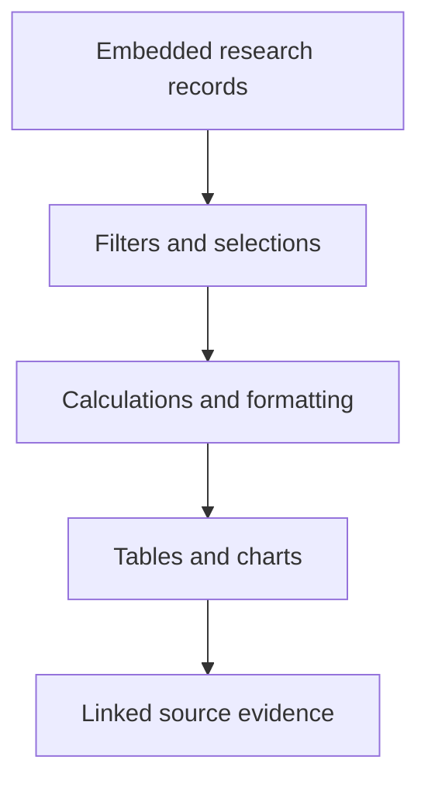
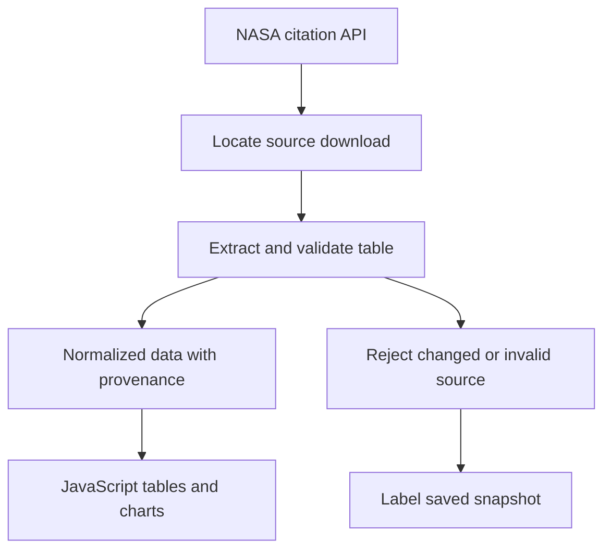

# AstroFlame — Flame in Freefall

**Challenge:** Flame in Freefall: SI-Powered Fire Safety Insights from Microgravity Combustion Data  
**Project:** An interactive research dashboard for exploring NASA combustion experiments and their relevance to astronaut fire safety.  
**Documentation date:** 15 November 2026

> **Version scope:** This README documents the supplied `Astroflame-Dasboard.html`. That file is a self-contained dashboard with embedded research data. A separate NASA API integration was developed during the project, but a completed deployment of that integration has not been verified. Features described as “integration development” below must not be presented as already running in the supplied HTML.

## Contents

- [Project overview](#project-overview)
- [Features and research coverage](#features-and-research-coverage)
- [Languages and technologies](#languages-and-technologies)
- [Getting started](#getting-started)
- [Architecture and file organization](#architecture-and-file-organization)
- [Complete methodology](#complete-methodology)
- [Calculations and interpretation](#calculations-and-interpretation)
- [NASA API integration](#nasa-api-integration)
- [Challenges and responses](#challenges-and-responses)
- [Testing and quality assurance](#testing-and-quality-assurance)
- [Limitations](#limitations)
- [Contributing and maintenance](#contributing-and-maintenance)
- [Team](#team)
- [Sources, credits and licensing](#sources-credits-and-licensing)

## Project overview

Research on combustion in microgravity is spread across technical papers, experiment descriptions, datasets and mission reports. These sources address different fuels, atmospheres, geometries and measurement methods, which makes direct comparison difficult.

AstroFlame organizes selected NASA research into one interface. Users can browse investigations, examine reported test conditions and gas measurements, follow source links, and understand how the studies relate to spacecraft fire hazards. The project makes existing research easier to explore; it does not conduct new spaceflight experiments or claim ownership of NASA's findings.

The dashboard addresses the challenge by connecting experimental evidence with readable comparisons and safety explanations. Its importance is educational and analytical: it helps users understand why Earth-based flame expectations cannot automatically describe fires in a spacecraft.

## Features and research coverage

| Section | Purpose |
| --- | --- |
| Overview | Introduces the project, team, catalog counts and research themes. |
| Data Explorer | Displays selected oxygen readings and a matrix of pressure, oxygen, fuel, geometry and airflow. |
| Experiment library | Organizes named investigations and mission campaigns, with research descriptions and sources. |
| Pollutants & test conditions | Shows selected BASS-II and Saffire measurements, CO-increase bars and a CO/CO₂ composition pie. |
| Research limitations | Shows source-supported operational constraints, scope boundaries and diagnostic caveats. |
| Safety issues | Explains gases, particles, spread, detection, heat, contamination and limited escape. |
| Ranking lab | Compares project-coded coverage of defined safety research areas. |

The supplied catalog has **7 families and 23 named entries**. These are the project's selected entries, not the total number of NASA combustion experiments. Its completion labels are a dated review, not a live mission-status feed.

The eight-entry limitations comparison uses a different grouping:

1. BASS / BASS-I
2. BASS-II
3. FLEX / FLEX-2
4. SoFIE, including SMµRF within its portfolio
5. ACME
6. Saffire I–VI
7. SPICE
8. SLICE

The different counts are intentional: a family, investigation, mission campaign and individual burn are different units of counting.

## Languages and technologies

### Supplied dashboard

| Technology | Role |
| --- | --- |
| **HTML5** | Page structure, navigation, forms, tables, cards and source links. |
| **CSS3** | Blue/yellow visual theme, layout, responsive breakpoints, animations and chart styling. |
| **JavaScript** | Filtering, navigation, calculations, chart updates, detail panels and browser interactions. |
| **SVG** | Icons, graphical elements and vector charts. SVG is a markup format. |
| **JavaScript objects / JSON** | Structured research records and data exports. JSON is a data format. |
| **Browser APIs** | DOM updates, event handling, local storage and file downloads. |

**JavaScript and Java are different languages. This website uses JavaScript, not Java.**

The supplied file does not require React, Vue, Angular, Java, a database or a paid AI API. It has no external `<script src>` dependencies and no `fetch()` calls. Its charts use HTML/CSS, SVG and JavaScript, including CSS gradients for the gas pie.

### Integration development

| Component | Intended or developed role | Status |
| --- | --- | --- |
| Node.js | JavaScript runtime for development, testing and server tooling | Used in integration development; not required by the supplied HTML. |
| NASA NTRS OpenAPI | Retrieve publication metadata and download locations | Queried during integration development. |
| Server-side JavaScript | Retrieve NASA sources and expose normalized datasets to the frontend | Developed separately; production deployment unverified. |
| D3.js | Render data-driven charts while preserving the visual design | Added to integration development; absent from the supplied HTML. |
| SHA-256 | Detect changes to the source used for a reviewed transcription | Implemented in the FLEX integration approach. |
| Python | Research extraction, file inspection and development support | Supporting tooling, not a browser language or a requirement for opening the dashboard. |
| Markdown | This README and repository documentation | Documentation format. |

## Getting started

### Requirements

- A modern browser, such as Chrome, Edge, Firefox or Safari.
- The supplied `Astroflame-Dasboard.html` file.
- Internet access to open external research sources.
- A text editor if you want to modify the code.

### Open the standalone dashboard

1. Download `Astroflame-Dasboard.html`.
2. Double-click it or open it from your browser.
3. Use the sidebar to navigate between sections.
4. Select datasets and experiment filters to update the displayed information.
5. Follow a source link to inspect the original research.

Most embedded interface content can be viewed offline. External research pages need internet access. Browser storage behavior can vary when the file is opened directly.

### Optional local web server

If Python 3 is installed, open a terminal in the folder containing the HTML and run:

```bash
python -m http.server 8000
```

Then open:

```text
http://localhost:8000/Astroflame-Dasboard.html
```

On Windows, `py -m http.server 8000` may be the appropriate command. Stop the server with `Ctrl+C`.

No `npm install` or build command is needed for the supplied single-file version. Do not use integration-specific commands unless the corresponding server source and package manifest are included in your checkout.

## Architecture and file organization

### Current single-file delivery

| File or section | Contents |
| --- | --- |
| `Astroflame-Dasboard.html` | Main deliverable, including interface, styles, scripts and embedded images. |
| `<style>` sections | Layout, theme, responsive rules, animations and visual components. |
| `dashboard-code` script | Research objects, rendering functions, filters and interaction handlers. |
| `README.md` | Project documentation. |

Important data structures include `SOURCES`, `FAMILIES`, `STUDIES`, `gasData`, `explorerRows` and `BASS_ROD_RUNS`.

Important functions include `setPage()`, `renderOverview()`, `renderCatalog()`, `renderGas()`, `renderGasPie()`, `showFamily()` and `showStudy()`. Export helpers also exist in the source; their availability to users depends on whether the corresponding controls are present.

### Browser data flow



For future maintenance, styles, data, source adapters and rendering logic can be separated into files. That is a suggested refactor, not the structure of the supplied delivery.

## Complete methodology

### 1. Define the problem and comparison scope

We organized the work around the difficulty of understanding scattered microgravity combustion evidence. We selected research families, established the dashboard sections and distinguished experiment-level descriptions from individual test measurements.

Before comparing results, define what is being compared: a burn, material, investigation, campaign or program. Do not treat these as interchangeable.

### 2. Collect primary research sources

We used NASA experiment descriptions, the NASA Technical Reports Server, research summaries and available physical-sciences records. Each usable result needs a source, test identifier and location within that source.

Keep publication dates, experiment dates and retrieval dates separate. A recent website upload date does not make an older experiment a new flight result.

### 3. Identify measurable variables

For each selected test, record the available fuel, sample dimensions, oxygen concentration, pressure, airflow, gas readings and outcome. Preserve whether a value describes a planned condition or a completed measurement.

A single common “flame intensity” or “flame speed” measure was not established across every study. The dashboard therefore uses condition tables and specific measurements rather than inventing complete curves across unrelated experiments.

### 4. Extract and verify the evidence

Read the original table or figure and retain its identifier. Check numerical values against row and column headings, units and explanatory notes. Where extracted PDF text scrambles columns, inspect the original page instead of trusting text order.

An API response containing a paper's title or abstract does not verify every measurement inside it. A source being reachable is also not proof that a particular interpretation is correct.

### 5. Organize structured records

Separate four types of information:

| Type | Example | Required treatment |
| --- | --- | --- |
| Reported measurement | Initial and final CO concentrations | Preserve source units and test ID. |
| Derived quantity | Final CO minus initial CO | Record the formula and inputs. |
| Editorial interpretation | Safety research coverage category | Label as an AstroFlame assessment. |
| Illustration | Flame behavior artwork | Label as explanatory, not measured data. |

For future normalized records, retain the experiment, run ID, quantity, units, source URL, page/table, extraction method, retrieval time and any uncertainty or censoring qualifier.

### 6. Normalize units without changing meaning

Convert units only where the conversion is defined. Distinguish mole or volume percentage from mass concentration; distinguish pressure from oxygen percentage; and distinguish a specimen's length from its diameter.

Preserve missing values as unavailable. Never replace them with zero. A reading such as `>1000 ppm` is a lower bound, not an exact concentration.

### 7. Build the interface

HTML establishes semantic sections, controls and data tables. CSS implements the visual theme and responsive layouts. JavaScript connects user selections to the corresponding records and redraws the relevant views.

The design keeps research context near the chart: experiment names, units, sample IDs and source links are part of the explanation, not optional decoration.

### 8. Calculate and render charts

The pollutant tables provide the inputs for the CO bars and gas pie. Data Explorer displays selected experimental conditions. Catalog counts are derived from selected catalog records, while limitation and safety counts use an explicitly defined editorial rubric.

Avoid joining unrelated observations into a curve that suggests a measured continuous relationship. Shared axes require compatible quantities and conditions.

### 9. Interpret safety relevance

We connect experiments to questions about gases, smoke, spread, suppression, detection and recovery. The distinction is between research that addresses a question and hardware that has demonstrated a specific protective performance.

A broader research program may cover more topics without proving that it is universally safer, more efficient or more effective than another program.

### 10. Review, test and maintain

Check numerical provenance, mathematical calculations, chart labels, source links, navigation and responsive behavior. Recheck extracted values when a source changes. Keep a record of corrections and the scope of each review.

For an API-enabled release, test successful refreshes, unavailable sources, changed source formats and stale-cache behavior before publication.

## Calculations and interpretation

### Carbon monoxide increase

```text
CO increase (ppm) = final CO (ppm) − initial CO (ppm)
```

For the selected BASS-II O6 record, the embedded readings are 1 ppm initially and 232 ppm finally, producing a 231 ppm increase. This is a concentration change, not an emission rate.

### Carbon dioxide conversion

```text
CO₂ increase (ppm by volume)
    = (final CO₂ vol% − initial CO₂ vol%) × 10,000
```

For O6, `(0.74 − 0.32) × 10,000 = 4,200 ppm`.

### Gas pie

```text
CO share (%) = ΔCO / (ΔCO + ΔCO₂) × 100
CO₂ share (%) = ΔCO₂ / (ΔCO + ΔCO₂) × 100
```

Both inputs must use the same concentration basis. The pie shows the shares of those two increases only. It excludes other gases, particles and background air. It is neither a toxicity score nor the composition of the entire cabin atmosphere. Reject an undefined or unsuitable denominator rather than drawing a misleading pie.

### Pressure conversions

```text
Pressure (kPa) = pressure (atm) × 101.325
Pressure (kPa) = pressure (mmHg) × 101.325 / 760
```

Use the measured table value when available, and retain the original unit in provenance. A nominal pressure in a figure caption may differ from the measured pressure in a table.

### Safety coverage ranking

The supplied ranking uses six categories:

1. Material flammability, fire spread and heat, grouped together.
2. Extinction and suppression.
3. Combustion gases.
4. Smoke and particles.
5. Detection.
6. Post-fire cleanup.

Each supported category counts once. The supplied assessment assigns Saffire 5/6 and BASS/BASS-II 3/6; these are **AstroFlame's source-based classifications**, not numerical scores issued by NASA. Every score requires an auditable category-to-source mapping.

### Research limitation counts

The limitation chart counts three categories: operational dependencies or disruptions, test-scope boundaries, and diagnostic caveats. A larger count means more categories were documented in the selected review. It does not measure severity or failure rate. Unconfirmed evidence must not be interpreted as proof that a limitation is absent.

The source also contains a separate weighted usefulness calculation:

```text
Score = 20 × Σ(weight × rating) / Σ(weight)
```

Those ratings are editorial judgments. This formula is distinct from the visible six-category safety coverage count and must not be described as measured NASA efficiency.

## NASA API integration

### What the supplied file does

The supplied HTML reads embedded records. It links to NASA publications but does not fetch NASA data at runtime. No live Gemini call or model inference is implemented there. AstroBot, where retained in this version, uses rule-based matching; it is not evidence of an AI model having verified the research.

### Integration development approach



NASA's documented NTRS OpenAPI provides citation metadata and download endpoints:

```text
GET https://ntrs.nasa.gov/api/citations/{id}
GET https://ntrs.nasa.gov/api/citations/{id}/downloads
GET https://ntrs.nasa.gov/api/citations/{id}/downloads/{filename}
```

Resolve download links from the returned record rather than guessing filenames. A full-text endpoint is not guaranteed to provide a clean machine-readable scientific table.

Integration development covered:

- BASS-II: deterministic extraction of selected O6–O9 gas readings.
- Saffire: extraction and joining of selected conditions and gas results by sample ID.
- FLEX: a reviewed PDF-table transcription checked against a SHA-256 fingerprint of the retrieved source text, because the automatic text ordering was unreliable.
- D3.js chart rendering, refresh-state labels and data/provenance export.
- A design to refresh on opening, manually and at 15-minute intervals while the page is visible.

These are historical research measurements. Refreshing their publication source does not turn them into live ISS sensor readings. A matching fingerprint confirms unchanged source bytes, not independent scientific validation of a transcription.

The public NTRS endpoints used in development did not require an API key. Optional future AI services must keep their credentials on the server. Do not put secrets in HTML, JavaScript bundles, screenshots or repository files.

Production publication, browser verification and packaging of the separate integration remain release requirements. This README does not provide a verified live deployment URL.

## Challenges and responses

| Challenge encountered | Response or remaining requirement |
| --- | --- |
| Papers use different fuels, geometries, units and endpoints. | Compare matched quantities; show condition-specific tables instead of inventing a universal metric. |
| Data are missing for some requested experiment/parameter combinations. | Show unavailable values and preserve the evidence gap. |
| PDF text extraction changes column order. | Inspect original tables; reject ambiguous parsing. FLEX required a reviewed transcription. |
| Existing FLEX values differed from the detailed results table. | Integration review corrected selected values, including FLEX-019 oxygen from 40% to 34%. Reconcile the supplied HTML before treating it as a corrected release. |
| Baseline gas concentrations vary between burns. | Calculate increases from each run's own initial and final readings. |
| A graph can imply safety or efficiency that the source never measured. | State what counts and percentages actually represent. |
| NASA browser requests can be affected by cross-origin restrictions. | Use a controlled server-side adapter where needed; verify the actual deployment behavior. |
| Source layout or availability can change. | Validate responses, retain provenance and label saved data when refresh fails. |
| Existing layout needed to stay intact. | Keep changes focused on data plumbing, labels and the requested heading animation. |
| Development preview did not start successfully. | Browser and production verification remain pending; parsing tests alone do not establish a working deployed site. |

## Testing and quality assurance

### Evidence from integration development

Seven focused checks passed during the development session: BASS gas calculations, Saffire table joins, rejection of missing tables, FLEX corrected values and pressure conversion, rejection of changed FLEX source content, handling NASA request errors, and JavaScript syntax checks.

Those checks were for the integration work, not a bundled test suite in the supplied standalone HTML. They do not establish scientific completeness or successful deployment.

### Release checklist

- [ ] Compare every displayed numerical row with its original source location.
- [ ] Check units, run IDs, baseline subtraction and rounding.
- [ ] Keep censored and missing values distinct from exact numbers.
- [ ] Verify every sidebar item, filter, detail panel and export control.
- [ ] Test keyboard navigation, visible focus, mobile layout and reduced motion.
- [ ] Verify chart tooltips, labels, denominators and dynamic scales.
- [ ] Test API timeouts, source changes and cache freshness labels.
- [ ] Confirm no credentials are shipped to the browser.
- [ ] Confirm images are labelled as source imagery or project illustrations.
- [ ] Verify the deployed page and its API responses before publishing a live-data claim.

## Limitations

- This is a selected research catalog, not an exhaustive NASA archive.
- The supplied version is static and contains values that need reconciliation with the integration review.
- Current completion status cannot be inferred from a dated catalog label.
- Concentration increases are not pollutant production rates; computing rates requires additional time, flow or volume information and an appropriate model.
- Laboratory and spacecraft results are condition-specific.
- The oxygen reference bands in Data Explorer are identified as Earth-based OSHA reference bands, not universal NASA spacecraft safety limits.
- Static artwork does not become experimental data because it appears beside NASA citations.
- The dashboard is an educational research tool, not certified flight hardware, an emergency procedure or an autonomous safety system.
- The supplied version has no user-account service, shared database or cross-device synchronization. Browser-local saved preferences remain local.

## Contributing and maintenance

For a data correction, provide the experiment, run ID, existing value, proposed value, unit, source URL and page/table. Explain whether the change affects a calculation, label, chart or interpretation.

Keep extraction, calculation and rendering logic separate when extending the application. Add tests for source-format changes and numerical transformations. Do not assign safety percentages, invent missing readings or automatically convert qualitative claims into measurements.

Before a release, update the review date, document changed source records, recheck links, record validation results and add a changelog entry. Publish repository and issue-tracker links only after those resources exist.

## Team

| Team member | Role |
| --- | --- |
| Prof. Imran Javed, Ph.D. | Team Owner |
| Ayaan Younas | Coder and Presenter |
| Hasnain Zaheer | Coder and Presenter |
| Abdullah Majid | Team Researcher and Presenter |
| Mubtasim Haider | Researcher and Assistor |

## Sources, credits and licensing

Key source locations:

- [NASA NTRS OpenAPI](https://ntrs.nasa.gov/api/openapi/)
- [NASA STI OpenAPI documentation](https://www.sti.nasa.gov/docs/20221122_OpenAPI_Documentation.pdf)
- [BASS-II Summary Report — 20210011385](https://ntrs.nasa.gov/citations/20210011385)
- [Detailed FLEX Results — 20150023456](https://ntrs.nasa.gov/citations/20150023456)
- [FLEX operations and lessons — 20120015928](https://ntrs.nasa.gov/citations/20120015928)
- [Saffire VI report — 20240002981](https://ntrs.nasa.gov/citations/20240002981)
- [SLICE CH* measurements — 20160012298](https://ntrs.nasa.gov/citations/20160012298)
- [NASA: Studying Combustion and Fire Safety](https://www.nasa.gov/missions/station/studying-combustion-and-fire-safety/)
- [NASA Physical Sciences Informatics](https://www.nasa.gov/physical-sciences-informatics-psi/psi-investigations-by-research-area/)

Scientific measurements and findings belong to their original investigators and publications. Credit NASA STI for NTRS data access and retain individual source attribution. Check each document and image's reuse terms, including third-party material; NASA hosting does not automatically grant the same license to everything on the site.

**Project code license:** No license has been selected in this documentation. The team should add a `LICENSE` file before granting reuse permissions. Do not assume that a public repository grants unrestricted reuse.

AstroFlame is an independent educational project using NASA research. NASA endorsement is not implied.

## README essentials before public submission

This document covers purpose, features, technology, setup, architecture, methodology, calculations, sources, challenges, testing, limitations, contributions, team and licensing status. Complete the following repository-specific items when available:

- Verified repository and live-demo links.
- Release number and changelog.
- Screenshots of the released version with captions and image credits.
- Actual dependency manifests and server setup instructions for an API-enabled release.
- A project license and a working issue/support channel.
- A reproducible test command with the tests included in the repository.

Only describe functionality as complete when it is present and verified in the version being submitted.
